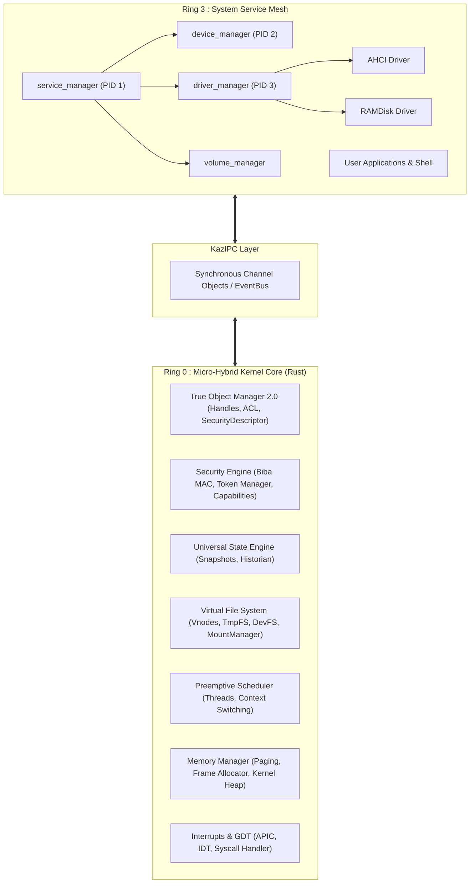

<div align="center">

# 🇰🇿 KAZAH OS
### Next-Generation Micro-Hybrid Operating System

[](https://www.rust-lang.org/)
[](https://github.com/a78722456-cell/kazah-os)
[](docs/architecture/01_kernel_architecture.md)
[](docs/architecture/02_security_and_state.md)
[](https://limine-bootloader.org/)
[-brightgreen.svg?style=for-the-badge)](docs/ROADMAP.md)

<p align="center">
  <b>"Git for the Operating System"</b><br/>
  An object-oriented, self-healing operating system designed for the security, resilience, and transparency standards of the 2040s.
</p>

[Vision](#-project-vision) •
[Key Innovations](#-key-innovations) •
[Architecture](#-architecture) •
[Roadmap](#-development-roadmap) •
[Repository Layout](#-repository-layout) •
[Getting Started](#-getting-started) •
[Documentation](#-documentation)

---

</div>

## 🌌 Project Vision

Operating systems today remain largely bound to designs conceived in the 1970s and 1980s: monolithic kernels where a single faulty third-party driver can crash the entire system (BSOD / Kernel Panic), fragile state configurations, and security models reliant on an all-powerful `root` / `Administrator` account.

**KAZAH OS** breaks this paradigm. 

Built from the ground up in modern **Rust (2024 Edition)**, KAZAH OS implements a **Micro-Hybrid Architecture (MHA)** where the Ring 0 kernel is reduced to a mathematically proven, minimal foundation (memory, scheduler, hardware interrupts, security, and fast IPC). All device drivers, filesystems, and system daemons operate in isolated Ring 3 userspace containers under an autonomous supervisor tree.

Central to KAZAH OS is the **Universal State Engine (USE)**: every system component (process, file, driver, socket, window) is a first-class versioned object. The entire operating system behaves like a transactional database with instant, non-destructive **Live Rollback** capabilities.

---

## ⚡ Key Innovations

### 1. ⏳ Universal State Engine ("Git for the OS")
- Every entity is modeled as a versioned `KernelObject`.
- The system continuously captures state snapshots in a ring-buffer timeline.
- If an update fails, a configuration is corrupted, or a driver faults, the system can instantly roll back to any past checkpoint without rebooting.

### 2. 🛡️ Zero-Trust Security by Design (Phase 8.7)
- **Mandatory Access Control (MAC)**: Biba-style *"No Write Up"* integrity model across 5 levels (`System`, `High`, `Medium`, `Low`, `Untrusted`).
- **Capability-Based Privileges**: Elimination of the monolithic superuser (`root`). Granular capabilities (`CAP_DRIVER_LOAD`, `CAP_STORAGE_ADMIN`, etc.) enforce strict least-privilege boundaries.
- **Discretionary Access Control (DAC)**: Fine-grained Access Control Lists (ACLs) bound to every object's `SecurityDescriptor`.
- **Integrated Audit Trail**: Every privilege elevation attempt and access denial is deterministically logged.

### 3. 🧩 True Object Manager 2.0
- Everything in the kernel is an object: `ProcessObject`, `ThreadObject`, `DeviceObject`, `DriverObject`, `FileObject`, `ChannelObject`.
- Universal header format containing unique 64-bit Object IDs, generation counters, access rights, and security metadata.
- Managed handle tables with automatic reference counting and zero memory leaks.

### 4. 🔄 Self-Healing Userspace Driver Mesh
- Hardware drivers (AHCI SATA, NVMe, RAMDisk) execute strictly in **Ring 3**.
- Driver crashes **never trigger kernel panics**.
- The `driver_manager` (PID 3) supervisor immediately intercepts faulted drivers, respawns them, and transparently re-binds hardware device IDs while buffering client IPC requests.

### 5. 🚀 KazIPC: Synchronous Deterministic Messaging
- Fast synchronous message channels connecting userspace services to each other and to the kernel.
- Zero-copy transfers for high-throughput block I/O.
- Cryptographic security tokens attached to message envelopes to prevent IPC spoofing.

### 6. 📁 Multi-Tier Storage & VFS (Phase 8.6 & 9)
- Modular storage hierarchy: `StorageDevice` $\rightarrow$ `Partition` $\rightarrow$ `Volume` $\rightarrow$ `VirtualVolume` $\rightarrow$ `VFS`.
- **VFS Layer**: Unified namespace with `Vnode` interfaces, `MountManager`, in-memory `TmpFS` root (`/`), and synthetic `DevFS` (`/dev`).

---

## 🏛️ Architecture



---

## 🗺️ Development Roadmap

| Phase | Subsystem | Description | Status |
| :--- | :--- | :--- | :--- |
| **Phase 1–4** | **Kernel Primitives** | Limine 7.x UEFI, 4-Level Paging, Frame Allocator, IDT, APIC, GDT. | ✅ **Completed** |
| **Phase 5** | **Preemptive Scheduler** | Kernel multithreading, context switching, TCB management. | ✅ **Completed** |
| **Phase 6** | **Userspace & Syscalls** | Ring 3 transition (`SYSRET`/`SYSCALL`), user-space copy guards. | ✅ **Completed** |
| **Phase 7** | **KazIPC Engine** | Synchronous IPC channels, handle passing, RPC primitives. | ✅ **Completed** |
| **Phase 8.1–8.5** | **Driver Architecture** | Ring 3 drivers, `device_manager`, `driver_manager`, self-healing runtime. | ✅ **Completed** |
| **Phase 8.6** | **Storage Framework** | StorageDevice, Partition, Volume Manager, AHCI, RAMDisk. | ✅ **Completed** |
| **Phase 8.7** | **Security Framework** | Zero-Trust MAC (Biba Integrity Levels), granular Capabilities, DAC ACL. | ✅ **Completed** |
| **Phase 9** | **Virtual File System** | Vnode abstraction, FileObject, TmpFS (`/`), DevFS (`/dev`), MountManager. | 🔄 **Active (Functional)** |
| **Phase 10** | **Kazah File System (KFS)** | Copy-on-Write native filesystem, snapshots, data block checksums. | ⏳ Planned |
| **Phase 10.5** | **Unified Page Cache** | Shared memory cache, mmap, dirty page writeback throttling. | ⏳ Planned |
| **Phase 11** | **KazNet Stack** | Ethernet (e1000/VirtIO), ARP, IPv4/IPv6, TCP/UDP sockets, TLS. | ⏳ Planned |
| **Phase 12** | **Graphics & Compositor** | UEFI Framebuffer, GPU drivers, zero-copy Wayland-style compositor. | ⏳ Planned |
| **Phase 13** | **Desktop Environment** | Window manager, Glassmorphism UI, Universal State Explorer, Driver Studio. | ⏳ Planned |
| **Phase 14** | **Symmetric Multiprocessing** | Multi-core APIC initialization, NUMA-aware scheduler, work-stealing. | ⏳ Planned |
| **Phase 15** | **Micro-Hypervisor** | Hardware virtualization (VT-x / AMD-V), lightweight container runtime. | ⏳ Planned |
| **Phase 16** | **KAZAH AI Layer** | Autonomous kernel telemetry tuning, AI automation studio, voice assistant. | ⏳ Planned |

---

## 📂 Repository Layout

```text
kazah_os/
├── .cargo/                 # Cargo build flags and bare-metal configurations
├── docs/                   # Full Architecture Specifications (KAS) & ADRs
│   ├── adr/                # Architecture Decision Records (0001 - 0005)
│   ├── architecture/       # Detailed component architecture specifications
│   ├── GETTING_STARTED.md  # Detailed build, run, and debugging walkthrough
│   └── ROADMAP.md          # Complete 16-phase strategic roadmap
├── kernel/                 # Ring 0 Micro-Hybrid Core (Rust bare-metal)
│   ├── src/
│   │   ├── arch/x86_64/    # Hardware assembly, GDT/IDT, Syscalls, PCI
│   │   ├── interrupts/     # Interrupt handlers, APIC timers
│   │   ├── memory/         # Paging, Frame Allocator, Kernel Heap, TAR parser
│   │   ├── object/         # True Object Manager 2.0, USE Historian, Handles
│   │   ├── security/       # Zero-Trust MAC, Capabilities, ACLs, Auditing
│   │   ├── task/           # Scheduler, Threads, Context Switching
│   │   ├── vfs/            # Vnode, FileObject, TmpFS, DevFS, MountManager
│   │   └── main.rs         # Kernel entry point
├── userspace/              # Ring 3 System Services & Test Suites
│   ├── libkazah/           # Standard userspace library, syscall wrappers, IPC
│   ├── service_manager/    # PID 1 init and service supervisor
│   ├── device_manager/     # PID 2 hardware device discovery
│   ├── driver_manager/     # PID 3 driver lifecycle and self-healing manager
│   ├── volume_manager/     # Storage volume and partition coordinator
│   ├── ahci/               # Ring 3 AHCI SATA storage driver
│   ├── ramdisk/            # Ring 3 RAM disk block driver
│   └── stress_*/           # Automated stress suites (VFS, IPC, Security, Crash)
├── build.ps1               # Automated build script (Userspace -> Initrd -> Kernel)
├── Cargo.toml              # Unified Cargo workspace definition
├── limine.conf             # Limine bootloader configuration
├── rust-toolchain.toml     # Nightly toolchain pinning
└── x86_64-kazah_os.json    # Custom bare-metal target specification
```

---

## 🛠️ Getting Started

### Prerequisites

- **Rust Nightly** (`rustup default nightly` + `rust-src`)
- **PowerShell** (5.1+ or 7+)
- **QEMU x86_64** (`qemu-system-x86_64`) with OVMF UEFI firmware

### Building the Operating System

Clone the repository and run the automated build script:

```powershell
# Build userspace, package initrd, and compile kernel
.\build.ps1
```

The script produces `iso_root/` ready for UEFI boot with the Limine bootloader and kernel image.

### Running in QEMU

Launch the OS in QEMU with serial output mirrored to your console:

```powershell
qemu-system-x86_64 `
    -m 512M `
    -bios "C:\Program Files\qemu\OVMF.fd" `
    -drive format=raw,file=fat:rw:iso_root `
    -serial stdio `
    -display none
```

---

## 📖 Documentation

- 📐 [Kernel Architecture & Service Mesh](docs/architecture/01_kernel_architecture.md)
- 🔒 [Zero-Trust Security & Universal State Engine](docs/architecture/02_security_and_state.md)
- 💾 [Storage Subsystem & Virtual File System (VFS)](docs/architecture/03_storage_and_vfs.md)
- ⚡ [KazIPC & System Service Mesh](docs/architecture/04_ipc_and_service_mesh.md)
- 🎨 [GUI Layer & UI/UX Design System](docs/architecture/08_gui_and_design_system.md)
- 🗺️ [Complete Strategic Roadmap (Phases 1–16)](docs/ROADMAP.md)
- 🚀 [Comprehensive Getting Started Guide](docs/GETTING_STARTED.md)

---

## 📄 License

Developed as part of the KAZAH OS Initiative. Licensed under the MIT License.
