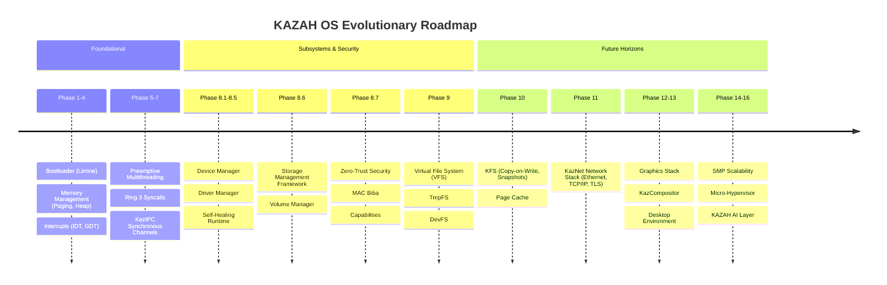

# KAZAH OS: Comprehensive Strategic Roadmap

**Project Started:** 2026.01.05  
**Current Phase:** Phase 9 (Virtual File System)  
**Target Architecture:** Micro-Hybrid, Rust-based, Zero-Trust, Object-Oriented OS

---

## 🗺️ Phase Overview

---

## Phase Details

### ✅ Phase 1–4: Kernel Core Foundations (Completed)
- **Bootloader**: Limine 7.x UEFI 64-bit boot protocol.
- **Physical Memory**: Bitmap frame allocator with buddy allocator semantics.
- **Virtual Memory**: 4-level x86_64 paging, recursive mapping, higher-half kernel.
- **Interrupts & Traps**: APIC timer, IDT, TSS, GDT with proper Ring 0 and Ring 3 privilege rings.
- **Heap Allocator**: Locked heap allocator with thread-safe global allocator.

### ✅ Phase 5: Preemptive Multithreading (Completed)
- Preemptive kernel scheduler.
- Hardware context switching saving general-purpose and SIMD registers.
- Thread control blocks (`ThreadObject`) integrated with Object Manager.

### ✅ Phase 6: Userspace & Syscalls (Completed)
- Transition to Ring 3 (User Mode) via `SYSRET`/`SYSCALL`.
- User address spaces and separate page tables.
- Robust user-pointer validation (`user_copy`) preventing privilege escalation.

### ✅ Phase 7: KazIPC (Synchronous Messaging) (Completed)
- Fast synchronous channel abstraction (`ChannelObject`).
- Zero-copy buffer transfer and handle passing.
- Deterministic client-server RPC semantics.

### ✅ Phase 8.1–8.5: Userspace Driver Architecture (Completed)
- Driver execution entirely in Ring 3.
- `device_manager` (PID 2) for PCI device scanning.
- `driver_manager` (PID 3) for driver lifecycle and hot-reload.
- Self-healing supervisor: automatic driver respawn and re-binding on fault without kernel panic.

### ✅ Phase 8.6: Storage Management Framework (Completed)
- Multi-tier storage hierarchy: `StorageDevice` -> `Partition` -> `Volume` -> `VirtualVolume`.
- AHCI SATA and in-memory RAMDisk drivers.
- Dynamic Volume Manager service.

### ✅ Phase 8.7: Zero-Trust Security Framework (Completed)
- **Mandatory Access Control (MAC)**: Biba-style "No Write Up" model with 5 Integrity Levels (System, High, Medium, Low, Untrusted).
- **Capability-Based Security**: Elimination of monolithic root; fine-grained capability bitflags (`CAP_DRIVER_LOAD`, `CAP_STORAGE_ADMIN`, etc.).
- **Discretionary Access Control (DAC)**: Access Control Lists (ACLs) attached to every `KernelObject`.
- **Security Auditing**: Centralized audit logging for security violations.

### 🔄 Phase 9: Virtual File System (VFS) (Active Development)
- Unified hierarchical namespace (`Vnode`, `FileObject`).
- In-memory `TmpFS` root (`/`).
- Dynamic device filesystem `DevFS` (`/dev`).
- Standard file syscalls: `open`, `read`, `write`, `close`, `mkdir`, `mount`.
- Transparent `MountManager` path resolution.

---

## 🔮 Upcoming Phases

### ⏳ Phase 10: Kazah File System (KFS)
- Native Copy-on-Write (CoW) disk filesystem.
- Snapshot integration with the Universal State Engine.
- Checksumming of data and metadata blocks to protect against bitrot.
- Inline compression and encryption.

### ⏳ Phase 10.5: Unified Page Cache
- Shared page cache for memory-mapped files (`mmap`).
- Writeback daemon and dirty page throttling.

### ⏳ Phase 11: KazNet Network Stack
- Ethernet driver architecture (Intel e1000, VirtIO-Net).
- ARP, IPv4, IPv6, ICMP.
- Zero-copy TCP and UDP socket layers.
- DNS, DHCP client, and userspace TLS.

### ⏳ Phase 12: Graphics Stack & KazCompositor
- UEFI Framebuffer and Hardware 2D/3D GPU drivers (VirtIO-GPU, AMD, Intel).
- Wayland-inspired zero-copy shared memory compositor.
- Subpixel font rasterization and vector rendering engine.

### ⏳ Phase 13: Desktop Environment & System Applications
- Modern, glassmorphism UI with GPU shader acceleration.
- Window Manager, Dock, Taskbar, Notification Center.
- Unique KAZAH OS management utilities:
  - **Universal State Explorer**: Interactive time-machine for every system object.
  - **Visual IPC Monitor**: Real-time 3D node graph of microservice interactions.
  - **Driver Studio**: Visual driver debugger and hot-reload control center.
  - **Kernel Observatory**: Real-time NUMA, CPU core, and memory analytics.

### ⏳ Phase 14: Symmetric Multiprocessing (SMP)
- Multi-core APIC initialization via ACPI MADT.
- Per-CPU runqueues with work stealing and NUMA awareness.

### ⏳ Phase 15: KazHypervisor & Micro-Containers
- Hardware virtualization (Intel VT-x / AMD-V).
- Lightweight isolated micro-VMs and container runtime.

### ⏳ Phase 16: KAZAH AI Layer
- AI-driven system automation and anomaly detection.
- Natural language system control and voice assistant daemon.
- Autonomous kernel tuning based on live telemetry.
