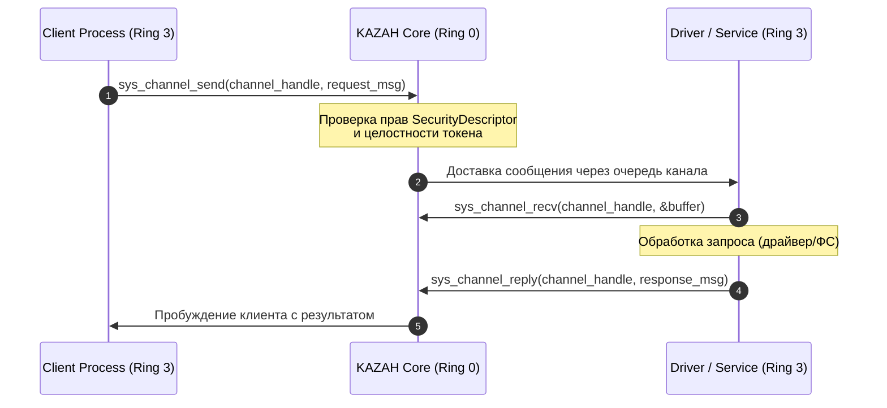

# KAZAH Architecture Specification (KAS) — 04. KazIPC & System Service Mesh

**Статус:** Официальная спецификация (v0.1.0-draft)  
**Компоненты:** KazIPC (Phase 7), Driver Runtime & Service Manager (Phase 8.1 - 8.5)

---

## 1. Концепция KazIPC

В микро-гибридной архитектуре межпроцессное взаимодействие (IPC) — это кровеносная система всей ОС. Любая неэффективность в IPC делает систему медленной, а любая уязвимость компрометирует границы безопасности.

**KazIPC** спроектирован с учетом следующих требований:
1. **Синхронный и детерминированный обмен сообщениями**: клиент блокируется до получения ответа или таймаута, исключая гонки данных и переполнение очередей.
2. **Нулевое копирование (Zero-Copy) для больших буферов**: передача указателей на совместно используемые регионы физической памяти с правами только для чтения/записи.
3. **Строгая типизация и безопасность**: каждое сообщение валидируется ядром на соответствие `SecurityToken` отправителя и получателя.

---

## 2. Архитектура каналов (Channel Objects)

В ядре связь между процессами абстрагирована через `ChannelObject`:



### Структура системных сообщений:
- `MessageHeader`: Идентификатор протокола, тип команды, размер полезной нагрузки, ID транзакции.
- `SecurityContext`: Прикрепленный токен безопасности, предотвращающий спуфинг отправителя.
- `Payload`: Бинарные данные запроса или дескрипторы передаваемых объектов (`HandlePassing`).

---

## 3. System Service Mesh & Supervisor

Вместо монолитных драйверов в Ring 0, сервисы KAZAH OS запускаются как независимые процессы пользовательского пространства под контролем иерархии супервизоров:

```
[ KAZAH Kernel (Ring 0) ]
           │
           ▼
[ service_manager (PID 1) ]  <─── Главный супервизор пользователей
      ├── [ device_manager (PID 2) ]  <─── Обнаружение оборудования (PCI, ACPI)
      ├── [ driver_manager (PID 3) ]  <─── Жизненный цикл и привязка драйверов
      │         ├── [ ahci driver (PID 4) ]
      │         └── [ ramdisk driver (PID 5) ]
      └── [ volume_manager (PID 6) ] <─── Управление разделами и LVM
```

### Механизм самовосстановления (Self-Healing Runtime)
1. **Обнаружение сбоя**: При возникновении исключения (Division by zero, Page Fault, Invalid Opcode) в процессе драйвера, ядро перехватывает его, изолирует процесс и переводит статус соответствующего `DriverObject` в `Faulted`.
2. **Оповещение супервизора**: Ядро отправляет событие через `EventBus` процессу `driver_manager`.
3. **Автоматический перезапуск**: `driver_manager` спавнит новый экземпляр драйвера.
4. **Повторная привязка (Re-bind)**: Новому экземпляру драйвера отправляется сообщение `BindDevice` с ID оборудования. Драйвер инициализирует регистры и восстанавливает работу.
5. **Прозрачность для приложений**: Клиентские запросы, отправленные во время сбоя, задерживаются в очереди и повторяются после восстановления драйвера без выброса фатальной ошибки пользователю.
