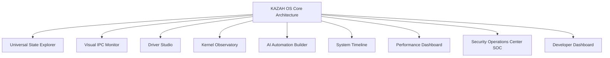

# KAZAH Architecture Specification (KAS) — 08. GUI Layer & UI/UX Design System

**Статус:** Официальная спецификация (v0.1.0-draft)  
**Компонент:** Графическая подсистема, композитор (KazCompositor), дизайн-система KAZAH UI/UX  

---

## 1. Концепция и масштаб графической экосистемы KAZAH OS

KAZAH OS создаётся как операционная система следующего поколения (уровня Windows/macOS и превосходящая их по прозрачности управления состоянием, безопасности и интеграции ИИ). Графический интерфейс пользователя (GUI) в KAZAH OS не ограничивается только рабочим столом и окнами приложений. Он охватывает **весь жизненный цикл вычислительного устройства** — от инициализации прошивки и анимации загрузки ядра до глубокой отладки драйверов, визуального мониторинга IPC-сообщений и управления снимками состояний.

Общий масштаб экосистемы интерфейсов KAZAH OS включает:
- **350–600 уникальных экранов и интерфейсных состояний.**
- **1000–2000 атомарных и составных UI-компонентов** (кнопки, стекловидные панели, графики NUMA/процессов, модальные диалоги, таймлайны).
- **40–60 дизайн-систем и подсистем тем** (типографика, векторная иконная сетка, физические кривые анимаций, шейдерные темы, пространственные звуки).

---

## 2. Уникальные интерфейсы KAZAH OS (Killer Features)

Именно эти 9 ключевых интерфейсов кардинально отличают KAZAH OS от существующих операционных систем:

### 2.1. Universal State Explorer (USE)
Визуальная машина времени для любого объекта системы. При выборе процесса, файла, окна, драйвера или службы пользователь видит интерактивный граф и временную шкалу:
$$\text{Object State}_t \longrightarrow \text{History Tree} \longrightarrow \text{Diff / Compare} \longrightarrow \text{Instant Snapshot Rollback}$$
- Возможность визуального сравнения двух снимков памяти или настроек с подсветкой изменённых страниц/атрибутов.

### 2.2. Visual IPC Monitor
Интерактивный 3D/2D-граф взаимодействия микросервисов и драйверов через **KazIPC** в реальном времени.
- Визуализация потоков сообщений, асинхронных вызовов, блокировок и очередей между ядром, драйверами и пространством пользователя.
- Фильтрация по частоте, латентности и пропускной способности.

### 2.3. Driver Studio
Интегральная среда управления аппаратным обеспечением и драйверами:
- Дерево устройств с индикацией изоляции в песочнице (IOMMU / Sandbox).
- Горячая замена (Hot-Reload) драйвера в реальном времени без перезагрузки ОС.
- Журнал событий и мгновенный откат драйвера (Rollback) на предыдущую стабильную версию при обнаружении ошибок.

### 2.4. Kernel Observatory
Панель наблюдения за низкоуровневой механикой ядра:
- Графики распределения памяти по узлам NUMA, состояния страниц (Active, Inactive, Wired, Compressed).
- Очереди планировщика задач по ядрам CPU, статистика аппаратных прерываний (APIC/MSI-X) и системных вызовов.

### 2.5. AI Automation Builder
Нокод/лоукод визуальный конструктор системных сценариев с поддержкой семантического анализа:
- Блочный интерфейс по принципу «Если произошло событие $X$ (например, нагрузка GPU > 90% или подключена USB-камера) $\rightarrow$ выполнить действия $Y$ через ИИ-агент».

### 2.6. System Timeline
Единая хронологическая ось всей ОС:
- Интеграция установок пакетов, обновлений ядра, изменений конфигурации, снимков KFS, сбоев приложений и действий пользователя в один скроллируемый поток времени.

### 2.7. Performance Dashboard
Глубокая аналитика аппаратных ресурсов и ИИ-подсистем:
- Детализированный мониторинг пропускной способности шин PCIe, температуры зон процессора, энергопотребления по микроамперам и утилизации NPU/AI-тензоров.

### 2.8. Security Operations Center (SOC)
Единый командный центр кибербезопасности:
- Карта угроз в реальном времени, статус аппаратной криптографии (TPM, Secure Boot, BitLocker/KazCrypt), управление песочницами приложений и интерактивный сетевой брандмауэр.

### 2.9. Developer Dashboard
Встроенная экосистема разработчика ОС:
- Интеграция встроенного IDE (Code Studio), терминала, профилировщика ядра, отладчика и инспектора служб в единое рабочее пространство.

---

## 3. Архитектура 40 основных UI-подсистем

Каждая подсистема проектируется с соблюдением принципов строгой изоляции (выполнение в отдельном процессе композитора или изолированном UI-контейнере с доступом через KazIPC).

### 1. Boot Experience
- **Экраны:** Boot Logo, BIOS/UEFI Splash, Loading Animation, Recovery Boot, Boot Menu, Safe Mode, Kernel Panic Screen, Crash Dump UI, Automatic Repair, BitLocker/KazCrypt Unlock, Dual Boot Menu.
- **Дизайн:** Минималистичная тёмная эстетика, плавные аппаратные шейдерные переходы (даже на этапе UEFI GOP), детальный вывод отладочной информации при сбоях с QR-кодом и графом стека.

### 2. OOBE (First Setup)
- **Экраны:** Welcome, Language, Region, Keyboard, Wi-Fi/Ethernet, Time Zone, User Account, Cloud Account, Privacy, Telemetry, AI Setup, Voice Assistant Setup, Developer Mode, Theme Selection, Wallpaper Selection, Finish.
- **Дизайн:** Мастер первоначальной настройки в виде бесшовного интерактивного путешествия с возможностью мгновенного включения режима разработчика на любом шаге.

### 3. Login & Authentication
- **Экраны:** Lock Screen, Password, PIN, Face ID (Biometric Windows Hello analog), Fingerprint, Hardware Security Key (FIDO2), QR Login, Guest Login, Multiple Users, Session Switch.
- **Дизайн:** Динамическое размытие фона (Glassmorphism), пространственная анимация аватаров, индикаторы аппаратной безопасности TPM.

### 4. Desktop Environment
- **Экраны:** Desktop Workspace, Context Menu, Desktop Widgets, Desktop Icons, Animated/GIF/Live Wallpapers, Virtual Desktops Overview, Multi-Monitor Matrix.
- **Дизайн:** Неограниченная кастомизация сетки, шейдерные обои, реагирующие на движение курсора и нагрузку системы.

### 5. Taskbar / Dock
- **Экраны:** Панель задач, кнопка «Пуск/KAZAH», запущенные приложения, закреплённые ярлыки, область уведомлений, системные часы и календарь, быстрые переключатели, мини-виджеты нагрузки (CPU/RAM/GPU/VPN).
- **Дизайн:** Плавающая или прикреплённая док-панель с поддержкой пружинных анимаций (Spring Dynamics).

### 6. Start Menu / App Launcher
- **Экраны:** Универсальный поиск, ИИ-поиск, недавно открытые файлы, закреплённые приложения, категоризированный каталог, быстрый доступ к питанию и настройкам.

### 7. Universal Search
- **Экраны:** Результаты по файлам, приложениям, настройкам, ИИ-семантический поиск, поиск по исходному коду, история запросов.

### 8. Notification Center
- **Экраны:** Лента уведомлений, группировка по приложениям, календарь, управление режимами фокусировки (Do Not Disturb / Focus Mode), виджеты, быстрый ответ.

### 9. Quick Settings (Control Center)
- **Экраны:** Слайдеры яркости и громкости, переключатели Wi-Fi, Bluetooth, VPN, Night Mode, запись экрана, создание скриншота, ИИ-ассистент, переключение профилей производительности (Eco, Balanced, Turbo, Extreme).

### 10. Settings (Системные параметры)
- **Экраны:** Полная иерархия настроек: General, About, System, Personalization, Network, Bluetooth, Storage, Power, Updates, Developer, SDK, Drivers, Hypervisor, Containers, Virtual Machines, Terminal, Package Manager, Logs, AI/Assistant, Memory, Privacy, Security, Antivirus, Firewall, Sandbox, Permissions, Encryption, TPM, Secure Boot.

### 11. File Manager (KazFiles)
- **Экраны:** Home, Sidebar, Drives, Network Shares, Recent, Search, Tags, Timeline, Preview Panel, Properties, ACL Permissions, Version History, KFS Snapshots, Compression & Deduplication Info.

### 12. Terminal (KazTerm)
- **Экраны:** Мультисплит (разделение экрана по горизонтали/вертикали), вкладки, SSH-менеджер, профили, шелл-темы, встроенный ИИ-помощник для команд, монитор производительности.

### 13. Code Studio (Встроенный IDE)
- **Экраны:** Файловый проводник, редактор кода с подсветкой синтаксиса, миникарта, интегрированный терминал, Git-клиент, визуальный отладчик, AI-чат для рефакторинга, менеджер расширений, профилировщик компилятора.

### 14. AI Assistant (KazAI)
- **Экраны:** Мультимодальный чат, голосовой ассистент, распознавание контекста экрана (Screen Understanding), автоматизация задач, отладка ошибок кода, системный контроль, анализ файлов, OCR и переводчик.

### 15. Web Browser (KazBrowser)
- **Экраны:** Вкладки, менеджер загрузок, хранилище паролей и ключей, DevTools, встроенный ИИ-помощник.

### 16. Package Manager UI (`kazpkg`)
- **Экраны:** Список установленных пакетов, доступные обновления, каталог (Store), поиск зависимостей, управление транзакциями и откат обновлений.

### 17. Application Store
- **Экраны:** Главная витрина, категории, карточки приложений, отзывы, обновления, песочница разрешений перед установкой.

### 18. Driver Manager
- **Экраны:** Установленные драйверы, поиск отсутствующих драйверов, обновления, откат на предыдущие версии, дерево шин.

### 19. Device Manager
- **Экраны:** Иерархия оборудования: CPU, GPU, USB, PCI/PCIe, SATA, NVMe, Audio, Network, Bluetooth, Camera.

### 20. Process Manager (Advanced Task Manager)
- **Экраны:** Вкладки процессов, системных служб, драйверов ядра, использования GPU/VRAM, сетевого трафика, ИИ-вычислений, карты памяти, IPC-каналов, открытых дескрипторов (Handles), планировщика потоков и узлов NUMA.

### 21. Universal State Engine UI
- **Экраны:** Панель инспекции состояний, граф истории изменений объекта, окно сравнения (Diff Viewer), интерфейс снапшотов и восстановления.

### 22. System Monitor
- **Экраны:** Высокоточныe векторные и шейдерные графики нагрузки CPU, RAM, Disk I/O, Network, GPU, датчиков температуры и NPU.

### 23. Antivirus & Security Suite
- **Экраны:** Дашборд безопасности, сканер, карантин, брандмауэр, журнал атак, управление изолированными песочницами, карта сетевых угроз.

### 24. Backup & Recovery Suite
- **Экраны:** Управление дедуплицированными снимками KFS, восстановление системы, облачная синхронизация, внешние накопители.

### 25. System Updates (KazUpdate)
- **Экраны:** Центр обновлений ядра, драйверов, моделей ИИ, системных приложений и прошивок UEFI.

### 26. Hypervisor & Virtualization
- **Экраны:** Менеджер виртуальных машин, управление снимками ВМ, проброс устройств (GPU/PCIe Passthrough), виртуальные коммутаторы и хранилища.

### 27. Network Center
- **Экраны:** Управление Wi-Fi, Ethernet, VPN-туннелями, правилами брандмауэра, DNS/DHCP, сетевая статистика и диагностика пакетов.

### 28. Media Suite
- **Экраны:** Аудиоплеер, видеопроигрыватель, галерея фотографий с ИИ-индексацией и каталогизатор медиафайлов.

### 29. Screenshot & Screen Recording
- **Экраны:** Оверлей захвата экрана, редактор аннотаций, распознавание текста (OCR), экспорт и шаринг.

### 30. Theme Engine (KazTheme)
- **Экраны:** Выбор цветовых палитр, иконографики, форм курсора, системных шрифтов, скорости анимаций, видеообоев и стилей виджетов.

### 31. Accessibility (Специальные возможности)
- **Экраны:** Экранная лупа, диктор (Экранный чтец с естественным ИИ-голосом), высококонтрастные темы, голосовое управление, настройки клавиатуры.

### 32. Recovery Console
- **Экраны:** Выбор точек восстановления системы, безопасный диагностический режим, проверка целостности KFS.

### 33. Developer Center
- **Экраны:** Управление установленными SDK (Kernel SDK, Driver SDK, UI SDK), документация API, сборщик пакетов, эмулятор устройств.

### 34. App Permissions Manager
- **Экраны:** Гранулярный контроль доступа приложений к камере, микрофону, файловой системе, геолокации, GPU, сети, буферу обмена и ИИ.

### 35. Animation & Physics System
- **Спецификация:** Динамика пружин (Spring/Damping) для открытия, закрытия, сворачивания окон, snap-разметки (Tiling/Splitting) и жестов тачпада.

### 36. Window Manager (KazWM)
- **Экраны:** Управление режимами окон: тайлинг (Tiling), плавающие окна (Floating), вкладки окон, сплит-скрин, полноэкранный режим.

### 37. Widgets Subsystem
- **Экраны:** Виджеты рабочего стола и панели уведомлений: Погода, Часы, Календарь, Заметки, ИИ-монитор, индикаторы нагрузки железа.

### 38. Voice Assistant Interface
- **Экраны:** Компактный плавающий оверлей прослушивания, визуализатор аудиоволн, транскрипция команд и история диалогов.

### 39. Login Animations
- **Спецификация:** Аппаратные 3D/2D переходы между экраном блокировки, авторизацией и появлением рабочего стола.

### 40. Error & Diagnostic Screens
- **Экраны:** Предупреждения безопасности, ошибки разрешений, сбои драйверов (Driver Panic с опцией мгновенного отката), ошибки ИИ и сетевых протоколов.

---

## 4. Дизайн-код и визуальные стандарты KAZAH OS

Дизайн-система KAZAH OS основана на трех китах:
1. **Glassmorphic Depth (Аппаратное стекло):** Использование физически корректных размытий фона с учетом глубины z-index и динамического освещения.
2. **Neon Cyber-Industrial Accent:** Сочетание глубокого обсидианово-тёмного фона с яркими неоновыми акцентами (бирюзовый, неоново-синий и золотой цвет степи), подчёркивающими высокую производительность.
3. **Strict Typographic Hierarchy:** Использование современных геометрических гротесков (Inter / Outfit / JetBrains Mono для кода и терминала).

---

## 5. Заключение
Данная спецификация является полным планом развития графического стека KAZAH OS, обеспечивающим создание до 600 экранов с сохранением единого стиля, высокой скорости отклика и прямой интеграции со STATE ENGINE ядра.
